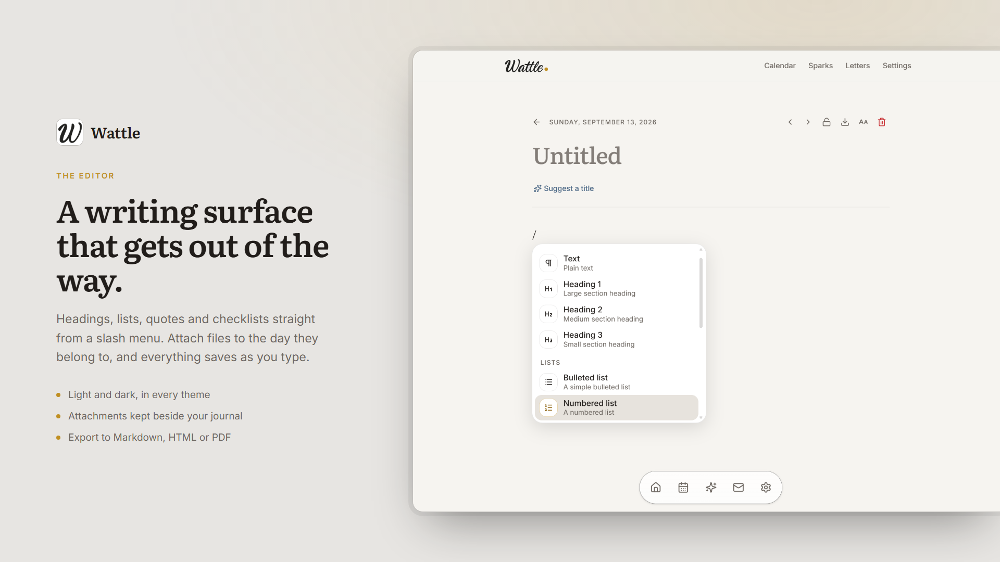
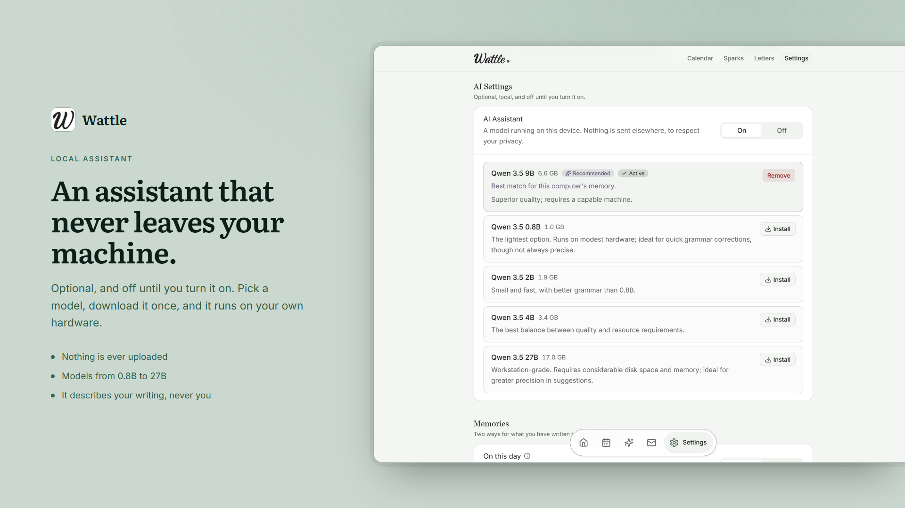
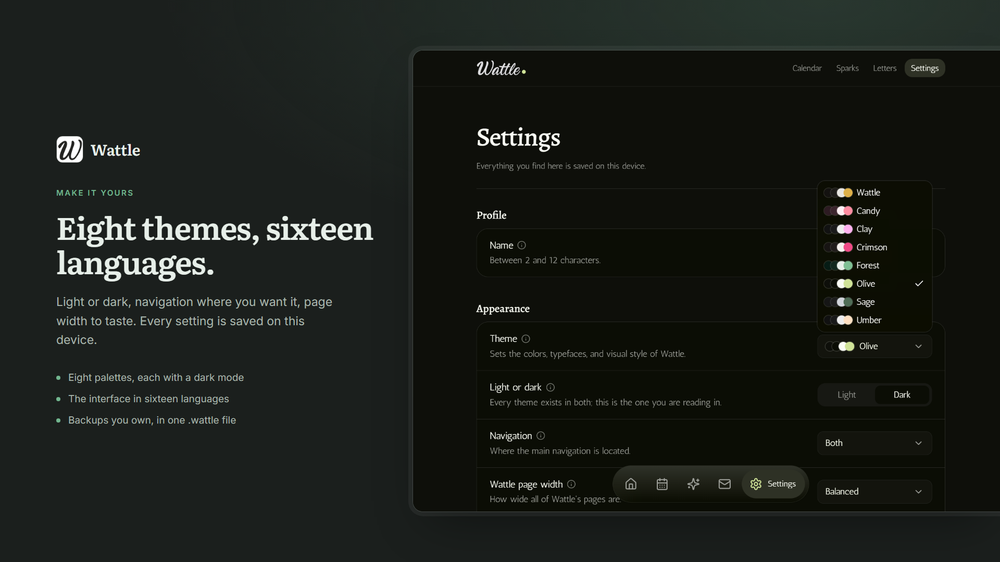

<div align="center">


# Wattle

**A private journal that lives entirely on your computer.**

No account · No cloud · No telemetry · Optional local AI


</div>

---

## What is Wattle?

Wattle is a place to write about your days - long pages, quick thoughts, even
letters to your future self - and read them back over time.

Everything stays on **your** machine, in one folder you can copy, move or back
up whenever you want. Nothing is uploaded, ever. If you like, a small AI model
running **on your own computer** can help you polish a sentence or bring back
something you had forgotten writing. If you don't, it stays off.

## ✨ Features

### ✍️ Write

- **Pages** - dated entries in a rich editor: headings, lists, quotes and checklists from a `/` menu.
- **Sparks** - one plain line for a passing thought, written in seconds.
- **Letters** - write something now and seal it until a date you choose.
- **Attachments** - add photos, PDFs and files to the day they belong to.
- **Writing prompts** - for when the blank page is the problem. Always optional.

<p align="center">
  
</p>

### 🕰️ Remember

- **On This Day** - what you wrote on this date in earlier years.
- **Echo** - an older spark returns each day.
- **Calendar** - month and year views; a fuller day is a day you wrote more.
- **Search** - across pages, sparks and opened letters, with highlighted matches.

### 🔒 Private by design

- Your journal **never leaves your device**. The only network connection is to a local AI, if you enable it.
- **One-file backups** - database, attachments and settings in a single `.wattle` file.
- **Export** to Markdown or HTML, readable anywhere, without Wattle.
- **Trash** - deleted pages wait until you restore them or remove them for good.

### 🤖 Optional local AI

- **Off by default.** Nothing runs and nothing is downloaded until you turn it on.
- Runs through [Ollama](https://ollama.com) on your own computer - pick a model from 0.8B to 27B.
- Rewrites a passage, suggests a title, finds related memories. **It never edits your writing on its own.**
- It describes your writing, never you, and always cites the pages it drew from.

<p align="center">
  
</p>

### 🎨 Make it yours

- **8 colour themes**, each with a light and a dark mode.
- **16 languages.**
- Adjustable reading width, navigation position and zoom.
- Pages open read-only when they already hold writing - one click unlocks them.
- Move your journal folder anywhere, whenever you like.

<p align="center">
  
</p>

## ❓ FAQ

<details>
<summary><b>Where is my journal stored?</b></summary>

In `Documents/Wattle` by default: one `wattle.db` file plus an `attachments/`
folder. You can move it anywhere from **Settings**.
</details>

<details>
<summary><b>What happens if I stop using Wattle?</b></summary>

Your journal is a plain SQLite database and a folder of files. Exports open in
any text editor or browser, and a `.wattle` backup is a regular ZIP archive
under a different name. Nothing is locked in.
</details>

<details>
<summary><b>Do I need the AI?</b></summary>

No. Wattle is complete without it. The AI is off until you switch it on in
Settings, and even then it runs only on your computer.
</details>

<details>
<summary><b>Which systems are supported?</b></summary>

Windows. The installer is available as an MSI package or an NSIS setup.
</details>

---

# 🛠️ For developers

**Tauri 2 · React 19 · TypeScript · Rust · SQLite**

- [Quick start](#quick-start)
- [Core concepts](#core-concepts)
- [Architecture](#architecture)
- [Project structure](#project-structure)
- [Data model and migrations](#data-model-and-migrations)
- [Search, export, backup](#search-export-backup)
- [Settings and appearance](#settings-and-appearance)
- [AI integration](#ai-integration)
- [Letters](#letters)
- [Design system and motion](#design-system-and-motion)
- [Contributing](#contributing)

## Quick start

**Requirements:** Node.js 22+, pnpm, and Rust 1.97.1 (the version pinned in CI and used to generate and check `THIRD-PARTY-NOTICES.txt`). See the [Tauri 2 prerequisites](https://tauri.app/start/prerequisites/). Packaging targets Windows (`x86_64-pc-windows-msvc`) and supports both MSI and NSIS installers. The MSVC build tools are required.

Ollama is optional.

```PowerShell
Copy-Item .env-sample .env
pnpm install
pnpm dev
```

| Command | What it does |
|---|---|
| `pnpm dev` | Run the desktop app in development |
| `pnpm build` | Web build → version sync → `tauri build` (Windows MSI and NSIS) |
| `pnpm build:web` | Vite build only, into `dist/` |
| `pnpm build:tauri` | Tauri bundle only |
| `pnpm version:bump` | Bump the patch version and stage the files that carry it |
| `pnpm check` / `pnpm fix` | Biome/Ultracite check / autofix |
| `pnpm check:translations` | Keep the sixteen language catalogues in step |
| `pnpm check:versions` | Confirm `package.json`, `tauri.conf.json`, `Cargo.toml` and `Cargo.lock` carry one version |
| `pnpm generate:notices` | Regenerate `THIRD-PARTY-NOTICES.txt` (needs Python 3, Cargo and installed dependencies) |
| `pnpm check:notices` | Fail if `THIRD-PARTY-NOTICES.txt` is out of date, without rewriting it |
| `pnpm generate:themes` | Regenerate `src/theme/palettes.generated.ts` |
| `pnpm generate:video` | Render the film to `preview/video/wattle.mp4` (installs its dependencies on first run) |
| `cargo test --manifest-path src-tauri/Cargo.toml` | The Rust test suite |
| `pnpm generate-barrels` | Regenerate barrel files |

`THIRD-PARTY-NOTICES.txt` ships in the installer and lists every third-party
crate, package and font in the Windows build. Run `pnpm generate:notices` and
commit the result whenever a dependency changes, a Dependabot update included,
or when the Rust toolchain changes: the notices reproduce the standard
library's own, so CI and the release workflow pin the toolchain (1.97.1) that
the committed file was generated with. CI runs `pnpm check:notices` and fails
when the file is stale. Licence texts that no package publishes are kept in `scripts/notices/vendor/`, with their sources in `scripts/notices/sources.json`.

There is **no frontend test runner**: UI changes are verified by hand. The Rust
suite covers persistence, search, migrations, the calendar, letters and the AI
plumbing.

## Core concepts

| Concept | What it is | How it reads |
|---|---|---|
| **Entry** | Long-form dated writing, rich text, attachments | Paper. Literata, reading width, unhurried |
| **Spark** | One thought, plain text | A note to yourself. Compact, italic, with a rail on its leading edge |
| **Memory** | Writing from this day in an earlier year, or an older entry about the same thing | Quiet. Recedes, dismissable |
| **Echo** | An older spark returning on a daily rotation | Same recession, still visibly a spark |
| **Letter** | A document sealed until a chosen date | A normal document while drafting; `--memory` once sealed |

**What the machine makes looks machine-made:** sans type and the `--assist`
token, where the journal is serif and `--wattle`.

Two rules hold on every AI surface, enforced in Rust:

- **It describes writing, not the writer.** Prompts forbid diagnosing, advising,
  judging, praising or reassuring.
- **Cited or dropped.** An observation that cannot name its source entries is
  discarded before it is stored.

### Routes

| Route | Page | Purpose |
|---|---|---|
| `/app` | `home.page.tsx` | Greeting, search, new entry, memories, timeline |
| `/app/calendar` | `calendar.page.tsx` | Month/year density grids |
| `/app/sparks` | `sparks.page.tsx` | Today's spark, the last six, the echo |
| `/app/sparks/all` | `sparks-all.page.tsx` | Archive, grouped by month, searchable |
| `/app/sparks/:id` | `spark.page.tsx` | One spark, edited in place |
| `/app/entries/:id` | `entry.page.tsx` | The full editor |
| `/app/letters` | `letters.page.tsx` | Drafts, sealed and opened letters |
| `/app/letters/new` | `letter-compose.page.tsx` | The composer |
| `/app/letters/:id` | `letter.page.tsx` | One letter |
| `/app/settings` | `settings.page.tsx` | Everything configurable, including the AI panel |
| `/app/settings/trash` | `trash.page.tsx` | Deleted pages |
| `/components` | `components.page.tsx` | Component gallery - **development only** |

`/` redirects to `/app`. Every screen is wrapped by `AppLayout`; all but the
home screen are lazy-loaded.
`.env` holds one variable, `NODE_ENV`. With `development`, a component gallery
is available at `/components`; with anything else it is removed from the build
entirely.


### Sparks are plain text

A spark is stored as a Tiptap document like an entry, because derived text,
full-text search, export and attachment reconciliation all read
`entries.content` as JSON. The composer flattens content on the way in and out
(`src/lib/spark-content.ts`). Older sparks with rich content are detected by
`isPlainSpark` and opened in the full editor - nothing is converted.

### Onboarding and tours

**Onboarding** replaces the shell while `settings.onboarded` is false: language,
blank or restored journal, name, backup folder, light or dark.

**Tours** are per route. `TOUR_STEPS` in
`src/components/widgets/guidance/page-tour.tsx` targets elements by
`data-tour-step-id`; seen tours are a list of strings in `settings.tours_seen`,
so adding one needs no migration.

## Architecture

- **Frontend** - React 19 + Vite. Redux Toolkit holds shared state (`entries`,
  `settings`, `profile`); screen-local state stays in `useState`. Routing lives
  in `src/routing/`.
- **Backend** - Rust in `src-tauri/`: one `Mutex<Connection>` around a bundled
  SQLite database, exposed through `#[tauri::command]` functions registered in
  `lib.rs`.
- **The seam** - every command uses serde DTOs with `rename_all = "camelCase"`,
  so TypeScript types mirror Rust types with no translation layer.

> <strong>IMPORTANT:</strong>
> `Settings` mirrors `SettingsDto` field for field and `saveSettingsThunk` posts
> it whole. The slice state is the wider `SettingsState` (e.g. the session-only
> `aiPulling`). Any session-only field must be **stripped** in
> `saveSettingsThunk` **and carried** through `hydrateSettings`,
> `clearSettings` and `resetSettings`.

<details>
<summary><b>Commands</b></summary>

| Area | Commands |
|---|---|
| Entries | `create_entry`, `update_entry`, `get_entry`, `list_entries`, `count_entries`, `delete_entry` |
| Temporal | `entry_dates_in_range`, `adjacent_entries`, `on_this_day`, `spark_echo` |
| Attachments | `add_attachment`, `list_attachments`, `delete_attachment`, `reconcile_entry_attachments` |
| Settings & profile | `load_settings`, `save_settings`, `load_profile`, `save_profile`, `reset_profile` |
| Export & backup | `export_entry_markdown`, `export_entry_html`, `export_journal_markdown`, `export_journal_html`, `entry_export_filename`, `create_backup`, `restore_backup` |
| Trash | `list_trash`, `restore_entry`, `purge_entry`, `empty_trash`, `trash_retention_days` |
| AI | `ai_status`, `ai_start_ollama`, `ai_install_ollama`, `ai_cancel_install`, `ai_rewrite`, `ai_cancel_rewrite`, `ai_pull_model`, `ai_cancel_pull`, `ai_delete_model` |
| Paths | `get_wattle_dir`, `move_journal_dir` |

Events: `ai://pull-progress` (bytes) and `ai://install-progress` (the
installer's own output - no invented percentage).
</details>

## Project structure

The codebase is organized by responsibility. Each directory owns a specific concern, keeping features isolated and shared logic easy to find.

### Frontend — `src/`

| Directory | Responsibility |
|---|---|
| `assets/` | Language flags and static assets |
| `components/` | Shared components across features |
| `components/ui/` | UI primitives (Base UI, shadcn base-nova) |
| `components/layout/` | App shell, headers and branding |
| `components/widgets/` | Self-contained navigation and guidance blocks |
| `components/development/` | Development-only component registry |
| `features/ai/` | AI panel, model catalogue, error mapping and suggestions |
| `features/calendar/` | Month and year density grids |
| `features/editor/` | Tiptap extensions, node views, menus and autosave |
| `features/entries/` | Entry list, On This Day and export |
| `features/letters/` | Commands, writing directions, duration and sealing |
| `features/sparks/` | Composer, cards and echoes |
| `hooks/` | Shared React hooks |
| `languages/` | i18next setup and translation catalogues |
| `lib/` | Generic utilities: dates, motion, spark content and `cn` |
| `pages/` | Route-level pages |
| `redux/` | Store, slices and types |
| `routing/` | Paths, navigation, layouts and route configuration |
| `styles/` | Global CSS and design system |
| `theme/` | Theme, appearance, zoom providers and palettes |

### Backend — `src-tauri/src/`

| Module | Responsibility |
|---|---|
| `commands/` | Command modules grouped by domain |
| `db/` | Schema, migrations and migration runner |
| `content.rs` | Tiptap document parsing, previews and word count |
| `crypto.rs` | Letter encryption and decryption — the only decryption entry point |
| `ollama.rs` | HTTP client, model catalogue, recommendations and embeddings |
| `ollama_runtime.rs` | Ollama discovery, startup and installation (Windows) |
| `models.rs` | DTOs crossing the frontend/backend boundary |
| `paths.rs` | Journal location and relocation |
| `state.rs` | Managed application state: connection, folder and cancellation flags |

New code should live alongside the existing code responsible for the same concern.

### Inside a feature

Feature folders are organized by **file responsibility**, not by topic. Each file has a clear place based on what it does.

Example — `src/features/letters/`:

| Location | Responsibility |
|---|---|
| `interfaces/` | Type definitions only. No runtime logic. |
| `functions/` | Command wrappers, parsers, error mapping and static catalogues. |
| `hooks/` | React hooks, one per file. |
| `*.tsx` | Components and contexts, with colocated props types. |

This convention keeps types, logic and UI concerns separate while making feature code predictable to navigate.

- A subfolder exists **only when needed** - nothing is scaffolded for later.
- A split module **keeps its filename** on both sides (`interfaces/letters.ts` ↔ `functions/letters.ts`).
- `import type` from `interfaces/`, value imports from `functions/`. Never `import type` something you call at runtime.

## Data model and migrations

<details>
<summary><b>Tables</b></summary>

| Table | Contents |
|---|---|
| `entries` | `id`, `title`, `content` (Tiptap JSON), derived `content_text` / `preview` / `word_count`, `kind` (`entry` \| `spark`), `entry_date` (`YYYY-MM-DD`), timestamps |
| `entries_fts` | FTS5 over `title` + `content_text`, kept in step by triggers. `unicode61 remove_diacritics 2`, `prefix = '2 3'`, no stemmer |
| `attachments` | One row per file, cascades from its entry; files under `attachments/<entry id>/` |
| `settings` | Single row: language, theme, zoom, navigation, feature switches, AI model, appearance, onboarding, backup folder, tours seen |
| `profile` | Single row: the reader's name |
| `entry_embeddings` | One vector per entry with `model`, `dim`, `updated_at`. Dropping it loses no writing |
| `letters` | Kept apart from `entries` so a sealed letter never reaches the FTS triggers. `status` is `draft` \| `sealed`; availability is derived |
| `letter_keys` | One 32-byte key per letter, in its own table |
| `letter_attachments` | Draft files under `attachments/letters/<id>/`; sealed files encrypted into `sealed-letters/<id>/` |
| `letters_fts` | Search index for **opened** letters only - no triggers; only the open function writes here |

The derived columns are computed on write by `content::derive`, so listing
entries never parses documents.
</details>

**Dates never cross a timezone.** An entry's date is a day, not an instant:
`YYYY-MM-DD` strings end to end, converted only in `src/lib/dates.ts`.

### Migrations

`src-tauri/src/db/mod.rs` holds an ordered array; **the index is the version**
(`user_version = n` → `n + 1`).

- Released migrations are **immutable**: never reorder, renumber or edit. Fix
  mistakes by appending a repair step.
- Before migrating, `VACUUM INTO` writes `wattle.db.pre-v<n>.bak`.
- A database from a **newer** Wattle is refused.
- A sealed letter's `id`, `unlock_on` and `sealed_at` are bound into its seal.
  Migrations **must never update them** - that would destroy the letter.

<details>
<summary><b>Migration history</b></summary>

| # | What it does |
|---|---|
| 1 | `settings.navigation` |
| 2 | Derived content columns, backfilled |
| 3 | Search index |
| 4 | Quarantines orphaned attachments |
| 5 | Repairs invalid entry dates |
| 6 | On This Day switch |
| 7 | `entries.kind` and its index |
| 8 | AI columns, default off |
| 9 | Spark echo switch |
| 10 | Entry lock, page width, accent |
| 11 | Onboarding, backup folder, tours seen (existing journals stamped as set up) |
| 12 | No-op - retired, kept so later numbers don't shift |
| 13 | `entry_embeddings` (empty) |
| 14 | `letters`, `letter_keys` (empty) |
| 15 | `letters_fts` (empty until a letter opens) |
| 16 | `letter_attachments` (empty) |
| 17 | Accent palette column |
| 18 | Trash tables, editor scale |
</details>

## Search, export, backup

**Search reaches everything the reader can read.** Home search covers every
kind, the timeline shows entries only, the spark archive scopes to sparks - all
through the same FTS index and `snippet()` highlighting. Opened letters join
through `letters_fts`; sealed letters and drafts are absent by construction.

**Export** writes Markdown or self-contained HTML: entries and sparks (`kind:`
in front matter), their attachments, and for HTML the stylesheet and font.
No letters, trash, settings or row ids. A single opened letter can be exported
from its own page.

**Backup** is the whole journal folder in one `wattle-backup-YYYY-MM-DD.wattle`
file. Ollama models are not included.

> <strong>WARNING:</strong>
> a **`.wattle` file is a ZIP** with a different name. `restore_backup` reads by
> content: do **not** add extension checks there, and do **not** reintroduce
> `.zip` anywhere - dialogs, filenames, the backup walk exclusion, or UI copy in
> any catalogue.

- Backups include sealed letters **and their keys, unencrypted** - by design
  (see [Letters](#letters)).
- `backup_dir` is where backup files go, and nothing else. It defaults to the
  journal folder. `create_backup` skips existing `wattle-backup-*` files, and
  `attachments/` is refused as a destination because restoring deletes it.
  With no folder set, a save dialog opens.

### Moving the journal

The location is stored in `journal-dir.txt` in the app config directory, not in
the database, because `resolve_wattle_dir` runs before `init_db`.

1. The connection is checkpointed and dropped.
2. `rename` is tried; across volumes it copies, verifies every file's length,
   then deletes the original.
3. The pointer is written **only after** the journal is verified at its new home.
4. Connection, base directory and asset scope are swapped under the db lock and
   the window reloads - no process restart.

Refused destinations: inside itself, a non-empty folder, a missing parent. If
the pointer names a folder that has gone (unplugged drive, renamed folder),
Wattle refuses to start and says where it looked, rather than creating an empty
journal. `setup` widens the asset protocol scope to the real attachments folder
on every launch; `sealed-letters/` is never in scope.

## Settings and appearance

Appearance is a set of **data attributes on `<html>`**, written by
`AppearanceProvider` and styled in `globals.css`:

| Attribute | Setting |
|---|---|
| `data-wattle-palette` | Colour theme (`wattle`, `candy`, `clay`, `crimson`, `forest`, `olive`, `sage`, `umber`) |
| `data-wattle-width` | Reading width |
| `data-wattle-editor-scale` | Editor text size |

Light/dark stays a class on `<html>` because Tailwind's `dark:` variant uses it.
Stored values are **names**, never measurements, so retuning is a CSS change,
not a migration. Palettes are generated by `pnpm generate:themes`.

- **Read-only by default** - `entry_lock` opens non-empty entries locked; new
  entries open ready to write.
- **Zoom** - Ctrl/Cmd `+` `-` `0`, 0.7-1.6, applied as the web view's own zoom
  (not CSS `zoom`, which breaks positioned popovers) and persisted.
- **Reset** - ordered by cost: preferences → tours → `reset_profile` (empties
  the journal, offers a backup first, returns to onboarding).

## AI integration

Optional, local, **off by default**. While `ai_enabled` is false there is no
request, no filesystem probe and no AI UI beyond the panel's switch in Settings.
The check lives in Rust (`require_enabled`).

- **Runtime** - `ollama_runtime.rs` finds, starts and (on Windows, via Ollama's
  own script) installs Ollama. Non-loopback `OLLAMA_HOST` is ignored.
- **Actions** - defined in Rust: `fixGrammar`, `makeShorter`,
  `improveClarity`, `suggestTitle`. Prompts are never caller-supplied.
- **Language** - output is in the *interface* language; the response grammar
  names its single field after that language (`rewrite_field` in
  `commands/ai.rs`).
- **`think: false` is mandatory** - otherwise reasoning models spend the whole
  context and return an empty 200.
- **Errors** are codes (`ai:noModel`, `ai:timeout`, …) translated by
  `src/features/ai/functions/ai-errors.ts`; Ollama's text is kept as detail.
- **Models** - installing is catalogue-only; removing accepts anything Ollama
  reports. The embedding model is not in `CATALOG`, so it can never become the
  active chat model (`find_chat_model`).
- **Nothing writes to the document** except an explicit accept handler.

### Model catalogue

One family, chosen for instruction following, valid structured output and all
sixteen languages on ordinary hardware.

| Tag | Download | Practical target |
|---|---|---|
| `qwen3.5:0.8b` | 1.0 GB | ~4 GB RAM, CPU only |
| `qwen3.5:2b-q4_K_M` | 1.9 GB | ~4-6 GB RAM, CPU only |
| `qwen3.5:4b` | 3.4 GB | ~8 GB RAM, CPU only - **default recommendation** |
| `qwen3.5:9b` | 6.6 GB | ~16 GB RAM |
| `qwen3.5:27b` | 17 GB | ~32 GB RAM |

<details>
<summary><b>Why these models, and how they are chosen</b></summary>

- **Targets, not promises.** `fits_in` warns; nothing blocks an install.
- **Why Qwen 3.5.** It spans every size and all sixteen languages. Granite 4
  and Llama 3.2 miss half of them; Gemma 3's small builds have a 32K window;
  Gemma 4's smallest build is larger than the 4B here.
- **Sizes are Ollama's published sizes for the exact tag.** Plain `qwen3.5:2b`
  is the 8-bit build at 2.7 GB; `2b-q4_K_M` fits a 4 GB machine.
- **Aliases are identical digests only** (`qwen3.5:latest` = 9B).
  `installed_tag_for` decides both "installed" and the tag sent to Ollama, so
  the two can never disagree. `ai_model` always stores the canonical id.
- **Context sent is per task and small** (4,096 tokens), whatever the model's
  256K window.
- **`recommended`** is the largest model that fits comfortably after
  `SYSTEM_RESERVE`, capped for CPU-only speed; 4B when memory can't be read.
  A badge, never a gate.
- **`keep_alive` is always explicit**, tiered by installed memory: 30s below
  ~10 GiB, 2m below ~20 GiB, 5m above, 30s if unknown. The embedder always
  takes the short one.
</details>

### Related memories

`commands/memories.rs` is the only user of embeddings. Indexing is an explicit
button in Settings (with count and Cancel); asking on an entry embeds only that
entry. **Nothing on save, at boot or on opening a page.** A match needs cosine
similarity ≥ `0.55` and at least `MEMORY_COOLDOWN_DAYS` (15) of distance; below
that, no card is shown. Brute-force search over normalised vectors is fast
enough (5,000 entries ≈ 20 MB, a few ms).

## Letters

A letter is written now and cannot be read again until a chosen date. While a
draft it is an ordinary document - same editor, attachments, autosave and AI
rewrite.

```
DRAFT ──seal──> SEALED ──(date passes)──> AVAILABLE ──open──> OPENED
  │                │                          │
  editable         no reading, editing,       derived - nothing is
  deletable        deleting or re-dating      written when this happens
```

Availability is **derived, never stored**: no background job, and a sealed row
is byte-identical before and after its date (a test asserts it).

### What the seal is - and is not

- **A commitment device.** The key sits beside the ciphertext and travels in
  backups, so a determined person with the file can decrypt it. The sealing
  screen says so.
- **Not a secret from someone holding your computer.** A passphrase would be
  forgotten in ten years and OS key wrapping doesn't survive a reinstall - a
  lost letter is worse than a readable one.
- **Proof against Wattle itself.** Exactly one function decrypts, using the
  machine's clock rather than an argument, and a source-level test asserts no
  other file can.
- **Attachments are sealed too** - encrypted into `sealed-letters/<id>/`, outside
  the asset scope. No listing, preview or filename until opened.
- **Editing the unlock date destroys the letter.** `id`, `unlock_on` and
  `sealed_at` are bound into the associated data; changing any of them makes
  decryption fail as corruption.
- **The only way out** before the date is emptying the whole journal, and the
  sealing screen says so before you commit.

### The envelope

Published so a letter can be decrypted without Wattle, in about twenty lines of
code. `src-tauri/src/crypto.rs` carries the same specification.

```
key        := letter_keys.key         32 bytes, OS CSPRNG, one per letter
nonce      := letters.nonce           24 bytes, OS CSPRNG, one per letter
algorithm  := letters.algorithm       "xchacha20poly1305"
envelope   := letters.envelope        1
plaintext  := the letter's Tiptap JSON document, UTF-8

aad        := "wattle-letter-v1" 0x1F <letters.id>
                                 0x1F <letters.unlock_on>   "YYYY-MM-DD"
                                 0x1F <letters.sealed_at>   ISO-8601 UTC

ciphertext := XChaCha20-Poly1305-Encrypt(key, nonce, plaintext, aad)
```

Attachments use the same key, their own nonce (`letter_attachments.nonce`) and:

```
aad        := "wattle-letter-attachment-v1" 0x1F <letters.id>
                                            0x1F <letter_attachments.id>
                                            0x1F <letters.unlock_on>
                                            0x1F <letters.sealed_at>
```

`0x1F` (ASCII unit separator) cannot occur in any of the fields. The AAD is
never stored; it is rebuilt from the row every time.

### Where the plaintext is not

After sealing: `secure_delete` overwrites freed pages,
`wal_checkpoint(TRUNCATE)` clears the WAL, and `VACUUM` rewrites the file. A
test seals a sentinel string and scans `wattle.db`, `-wal` and `-shm` with the
connection still open.

Two known channels remain: a pre-migration `.bak` snapshot taken while the
letter was a draft, and SSD wear levelling.

### Deliberately missing

- **No countdowns** anywhere. `relativeDaysAgo` is past-only by construction.
- **No interview.** Seven static writing directions; picking one may ask the
  local model for a single starting question, never stored.
- When AI is unavailable (`aiEnabled && aiModel !== ""` is false) the composer
  shows a notice, dismissable **for that visit only**. Failures past that gate
  (no Ollama, timeout) are silent: `askLetterQuestion` returns `""`.

## Design system and motion

Everything lives in `src/styles/globals.css`.

- **Type** - serif (Literata) is what *you* wrote; sans (Inter) is the app
  talking. AI suggestions are sans until accepted.
- **Size tokens** - `--text-display`, `--text-title`, `--text-body`,
  `--text-body-sm`, `--text-meta`, `--text-eyebrow`.
- **Elevation** - `--shadow-raise` (hover), `--shadow-float` (popovers),
  `--shadow-bar` (floating nav).
- **Width** - `--width-reading` for reading, `--width-column` for scanning.
- **Selection** - `body` is `select-none`; inputs and the editor are
  `select-text`.

| Colour token | For | Rule |
|---|---|---|
| `--wattle` | The journal's accent | Focus, active nav, density, spark rail |
| `--assist` | Everything AI | Cool, low-chroma. AI never uses `--wattle` |
| `--memory` / `--memory-surface` | Resurfaced writing | Recedes by size and surface, **never** by contrast (stays AA) |

**Motion** - constants in `src/lib/motion.ts`, `MotionConfig
reducedMotion="user"` at the root. Animation must mean **continuity**,
**causality** or **arrival** - never decoration.

- Navigation pill: shared `layoutId`, instant on first paint.
- Lists fade and rise in with `initial={false}`.
- `PageIntro`: blur-and-fade on mount only; nothing animates on exit, so
  autosave flushes aren't delayed.
- Not animated: route transitions, editor content, the spark archive.

## Contributing

Before committing:

```PowerShell
pnpm generate-barrels
pnpm check
pnpm check:translations
pnpm check:versions
pnpm check:notices
cargo test --manifest-path src-tauri/Cargo.toml
```

A lefthook pre-commit hook runs `ultracite fix` on staged files.

**Code style** - Ultracite (Biome), strict. Hook dependency arrays are enforced
(use `biome-ignore` with a reason for trigger-only dependencies), no arrow
functions as JSX props, and a cognitive-complexity ceiling that usually means
"extract a component". Imports name the file they come from; the legacy
barrelsby barrels in `src/components/` and `src/redux/` are unused and new code
should not add more.

---

## License

MIT - see [LICENCE](LICENCE).
